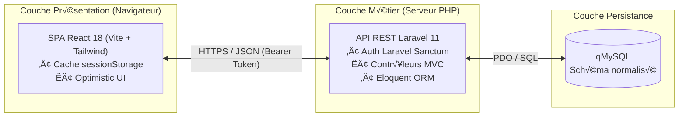
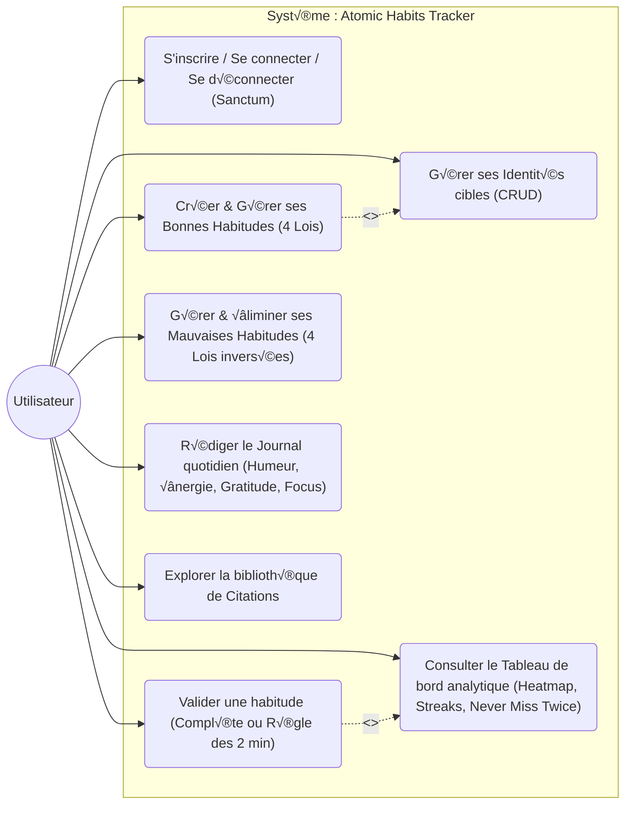
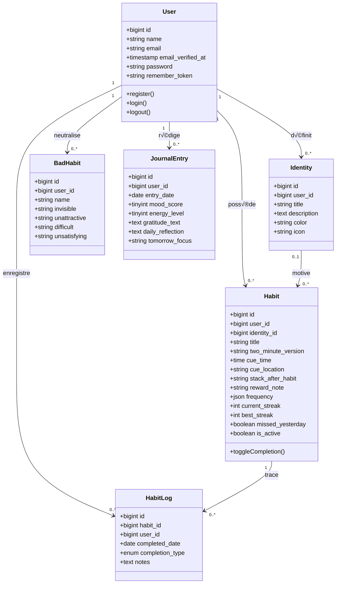
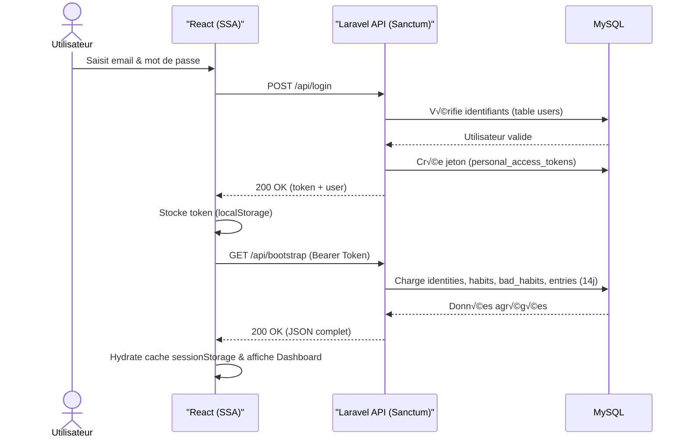
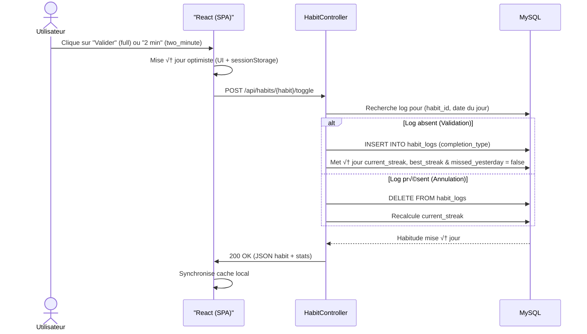
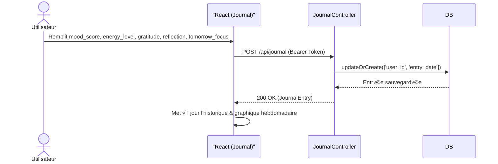

# Architecture & Conception — Atomic Habits Tracker

Ce document présente l'architecture technique, la modélisation UML et la conception de la base de données (Merise) de l'application **Atomic Habits Tracker**, alignées sur l'implémentation réelle (Laravel 11 & React 18).

---

## 1. Architecture Technique & Choix d'Optimisation

L'application repose sur une architecture **3-Tiers découplée (Client-Serveur RESTful)** :

* **Couche Présentation (Frontend — React 18 / Vite / Tailwind CSS) :** Single Page Application (SSA) communiquant via Axios avec jeton Bearer (`Laravel Sanctum`). Elle intègre un **hydratage initial groupé** (`GET /api/bootstrap`) couplé à un cache local (`sessionStorage`) et une mise à jour optimiste de l'interface (*Optimistic UI*) pour une navigation instantanée.
* **Couche Métier (Backend — Laravel 11) :** API REST sécurisée par **Laravel Sanctum**, structurée selon le pattern MVC (Routes API ↂ Contrôleurs REST ↂ Modèles Eloquent).
* **Couche Persistance (Base de données — MySQL) :** Schéma relationnel normalisé avec contraintes d'intégrité référentielle (`ON DELETE CASCADE` / `SET NULL`), indexation sur les dates (`completed_date`) et contraintes d'unicité composites (`(habit_id, completed_date)` et `(user_id, entry_date)`).



---

## 2. Modélisation UML

### 2.1 Diagramme de Cas d'Utilisation (Use Case)



### 2.2 Diagramme de Classes



### 2.3 Diagrammes de Séquence

#### A. Authentification & Hydratage Initial (`/api/bootstrap`)


#### B. Validation d'une Habitude (`POST /api/habits/{habit}/toggle`)


#### C. Enregistrement du Journal Quotidien (`POST /api/journal`)


---

## 3. Modélisation Merise (MCD, MLD, MPD)

### 3.1 Modèle Conceptuel de Données (MCD)=
```mermaid
erDiagram
    UTILISATEUR ||--o{b‘»LB¢&L:ñfñÊóB ¢UDîƒï4DUU"«¬“÷˜≤Ñ$ïETDR¢'˜7<:ÜFR ¢UDîƒï4DUU"«¬“÷˜≤ƒÙuÙÑ$ïETDR¢&VÁ&Vvó7G&R ¢UDîƒï4DUU"«¬“÷˜≤‘Udï4UÙÑ$ïETDR¢&ÊWWG&∆ó6R ¢UDîƒï4DUU"«¬“÷˜≤TÂE$TUÙ§ıU$‰¬¢',:ñFñvR ¢îDTÂDïDR∆Ú“÷˜∂Ñ$ïETDR¢&÷˜FófR ¢Ñ$ïETDR«¬“÷˜≤ƒÙuÙÑ$ïETDR¢'G&6R †¢UDîƒï4DUU"∞¢&ñvñÁBñB∞¢7G&ñÊrÊ÷P¢7G&ñÊrV÷ñ¿¢7G&ñÊr77v˜&@¢–¢îDTÂDïDR∞¢&ñvñÁBñB∞¢7G&ñÊrFóF∆P¢FWáBFW67&óFñˆ‡¢7G&ñÊr6ˆ∆˜ ¢7G&ñÊrñ6ˆ‡¢–¢Ñ$ïETDR∞¢&ñvñÁBñB∞¢7G&ñÊrFóF∆P¢7G&ñÊrGvıˆ÷ñÁWFU˜fW'6ñˆ‡¢Fñ÷R7VU˜Fñ÷P¢7G&ñÊr7VUˆ∆ˆ6Fñˆ‡¢7G&ñÊr7F6µˆgFW%ˆÜ&ó@¢7G&ñÊr&Wv&EˆÊ˜FP¢ß6ˆ‚g&WVVÊ7ê¢ñÁB7W'&VÁE˜7G&V∞¢ñÁB&W7E˜7G&V∞¢&ˆˆ∆V‚÷ó76VE˜ñW7FW&Fê¢&ˆˆ∆V‚ó5ˆ7FófP¢–¢ƒÙuÙÑ$ïETDR∞¢&ñvñÁBñB∞¢FFR6ˆ◊∆WFVEˆFFP¢VÁV“6ˆ◊∆WFñˆÂ˜GóP¢FWáBʘFW0¢–¢‘Udï4UÙÑ$ïETDR∞¢&ñvñÁBñB∞¢7G&ñÊrÊ÷P¢7G&ñÊrñÁfó6ñ&∆P¢7G&ñÊrVÊGG&7FófP¢7G&ñÊrFñffñ7V«@¢7G&ñÊrVÁ6Fó6gññÊp¢–¢TÂE$TUÙ§ıU$‰¬∞¢&ñvñÁBñB∞¢FFRVÁG'ïˆFFP¢FñÁññÁB÷ˆˆE˜66˜&P¢FñÁññÁBVÊW&wïˆ∆WfV¿¢FWáBw&FóGVFU˜FWá@¢FWáBFñ«ï˜&Vf∆V7Fñˆ‡¢7G&ñÊrFˆ÷˜'&˜uˆfˆ7W0¢–¶†¢2222„"÷ˆL:Ü∆R∆ˆvóVRFRFˆÊÏ:ñW2Ñ‘ƒBꆢ¢¢ßW6W'2¢¢Ç¢¶ñF¢¢¬Ê÷V¬V÷ñ∆¬V÷ñ≈˜fW&ñfñVEˆF¬77v˜&F¬&V÷V÷&W%˜Fˆ∂Vʬ7&VFVEˆF¬WFFVEˆFꢢ¢¶ñFVÁFóFñW2¢¢Ç¢¶ñF¢¢¬7W6W%ˆñF¬FóF∆V¬FW67&óFñˆÊ¬6ˆ∆˜&¬ñ6ˆÊ¬7&VFVEˆF¬WFFVEˆFꢢ¢¶Ü&óG2¢¢Ç¢¶ñF¢¢¬7W6W%ˆñF¬6ñFVÁFóGïˆñF¬FóF∆V¬Gvıˆ÷ñÁWFU˜fW'6ñˆÊ¬7VU˜Fñ÷V¬7VUˆ∆ˆ6FñˆÊ¬7F6µˆgFW%ˆÜ&óF¬&Wv&EˆÊ˜FV¬g&WVVÊ7ñ¬7W'&VÁE˜7G&V∂¬&W7E˜7G&V∂¬÷ó76VE˜ñW7FW&Fñ¬ó5ˆ7FófV¬7&VFVEˆF¬WFFVEˆFꢢ¢¶Ü&óEˆ∆ˆw2¢¢Ç¢¶ñF¢¢¬6Ü&óEˆñF¬7W6W%ˆñF¬6ˆ◊∆WFVEˆFFV¬6ˆ◊∆WFñˆÂ˜GóV¬ʘFW6¬7&VFVEˆF¬WFFVEˆFꢢ¢¶&EˆÜ&óG2¢¢Ç¢¶ñF¢¢¬7W6W%ˆñF¬Ê÷V¬ñÁfó6ñ&∆V¬VÊGG&7FófV¬Fñffñ7V«F¬VÁ6Fó6gññÊv¬7&VFVEˆF¬WFFVEˆFꢢ¢¶¶˜W&Ê≈ˆVÁG&ñW2¢¢Ç¢¶ñF¢¢¬7W6W%ˆñF¬VÁG'ïˆFFV¬÷ˆˆE˜66˜&V¬VÊW&wïˆ∆WfV∆¬w&FóGVFU˜FWáF¬Fñ«ï˜&Vf∆V7FñˆÊ¬Fˆ÷˜'&˜uˆfˆ7W6¬7&VFVEˆF¬WFFVEˆFꆢ2222„2÷ˆL:Ü∆Ráó6óVRFRFˆÊÏ:ñW2Ñ’B(	B◊ï5¬ê†ß¬F&∆R¬6Ã:í&ñ÷ó&R¬6Ã:ó28óG&Ê|:á&W2b,:Üv∆W2¬ñÊFWÇb6ˆÁG&ñÁFW2BuVÊñ6óL:í¿ß¬¢“““¬¢“““¬¢“““¬¢“““¿ß¬¢¶W6W'6¢¢¬ñFÜ$îtîÂBTÂ4ît‰TFí¬(	B¬¬T‰ïTRÜV÷ñ¬ñ¿ß¬¢¶ñFVÁFóFñW6¢¢¬ñFÜ$îtîÂBTÂ4ît‰TFí¬W6W%ˆñF(i"W6W'2ÜñBñÜÙ‚DTƒUDR444DUÇó¬(	B¬¿ß¬¢¶Ü&óG6¢¢¬ñFÜ$îtîÂBTÂ4ît‰TFí¬W6W%ˆñF(i"W6W'2ÜñBñÜÙ‚DTƒUDR444DVì∆'#ÊñFVÁFóGïˆñF(i"ñFVÁFóFñW2ÜñBñÜÙ‚DTƒUDR4UBÂTƒ∆¬ÁV∆∆&∆Rí¬L:ñfWG2¢7W'&VÁE˜7G&V≥”¬&W7E˜7G&V≥”¬÷ó76VE˜ñW7FW&Fì÷f«6V¬ó5ˆ7FófS◊G'VV¿ß¬¢¶Ü&óEˆ∆ˆw6¢¢¬ñFÜ$îtîÂBTÂ4ît‰TFí¬Ü&óEˆñF(i"Ü&óG2ÜñBñÜÙ‚DTƒUDR444DVì∆'#ÊW6W%ˆñF(i"W6W'2ÜñBñÜÙ‚DTƒUDR444DVí¬î‰DUÇÜ6ˆ◊∆WFVEˆFFRñ∆'#ÊT‰ïTRÜÜ&óEˆñB¬6ˆ◊∆WFVEˆFFRñC∆'#ÊTÂT“ÇvgV∆¬r¬wGvıˆ÷ñÁWFRrñ¿ß¬¢¶&EˆÜ&óG6¢¢¬ñFÜ$îtîÂBTÂ4ît‰TFí¬W6W%ˆñF(i"W6W'2ÜñBñÜÙ‚DTƒUDR444DVí¬6ˆ∆ˆÊÊW2FW2B∆ˆó2ñÁfW'<:ñW2ÁV∆∆&∆R¿ß¬¢¶¶˜W&Ê≈ˆVÁG&ñW6¢¢¬ñFÜ$îtîÂBTÂ4ît‰TFí¬W6W%ˆñF(i"W6W'2ÜñBñÜÙ‚DTƒUDR444DVí¬T‰ïTRáW6W%ˆñB¬VÁG'ïˆFFRñ∆'#ÊDîÂîîÂF˜W"÷ˆˆE˜66˜&VWBVÊW&wïˆ∆WfV∆É:Rí¿†¢““–†¢22B‚6'Fˆw&ÜñRFW2VÊGˆñÁG2í$U5BÜ&˜WFW2ˆíÁáê†ß¬‹:óF܈FR¬VÊGˆñÁB¬6<:á2¬6ˆÁG,;F∆WW"¬,;F∆R¿ß¬¢“““¬¢“““¬¢“““¬¢“““¬¢“““¿ß¬ı5F¬ˆí˜&Vvó7FW&¬V&∆ñ2¬WFÑ6ˆÁG&ˆ∆∆W$&Vvó7FW&¬7,:ñFñˆ‚FR6ˆ◊FR≤:ñ÷ó76ñˆ‚Fˆ∂V‚6Ê7GV“¿ß¬ı5F¬ˆíˆ∆ˆvñʬV&∆ñ2¬WFÑ6ˆÁG&ˆ∆∆W$∆ˆvñʬWFÜVÁFñfñ6Fñˆ‚≤:ñ÷ó76ñˆ‚Fˆ∂V‚6Ê7GV“¿ß¬tUF¬ˆíˆ÷V¬&˜L:ñ|:í¬WFÑ6ˆÁG&ˆ∆∆W$÷V¬&ˆfñ¬FR¬wWFñ∆ó6FWW"6ˆÊÊV7L:í¿ß¬ı5F¬ˆíˆ∆ˆv˜WF¬&˜L:ñ|:í¬WFÑ6ˆÁG&ˆ∆∆W$∆ˆv˜WF¬,:ófˆ6Fñˆ‚GRFˆ∂V‚6˜W&ÁB¿ß¬tUF¬ˆíˆ&ˆ˜G7G&¬&˜L:ñ|:í¬6∆˜7W&R˜Fñ÷ó<:ñR¬,:ñ6Ü&vV÷VÁBw&˜W:íÜñFVÁFóL:ó2¬Ü&óGVFW2¬÷Wfó6W2Ü&óGVFW2¬¶˜W&ʬí¿ß¬tUBıı5BıUBÙDT∆¬ˆíˆñFVÁFóFñW6¬&˜L:ñ|:í¬ñFVÁFóGî6ˆÁG&ˆ∆∆W&¬5%TBFW2ñFVÁFóL:ó26ñ&∆W2¿ß¬tUBıı5BıUBÙDT∆¬ˆíˆÜ&óG6¬&˜L:ñ|:í¬Ü&óD6ˆÁG&ˆ∆∆W&¬5%TBFW2&ˆÊÊW2Ü&óGVFW2ÉB∆ˆó2í¿ß¬ı5F¬ˆíˆÜ&óG2˜∂Ü&óG“˜Fˆvv∆V¬&˜L:ñ|:í¬Ü&óD6ˆÁG&ˆ∆∆W$Fˆvv∆V¬f∆ñFFñˆ‚ˆÊÁV∆Fñˆ‚V˜FñFñVÊÊRÜgV∆∆ÚGvıˆ÷ñÁWFVíWB6∆7V¬FR7G&V≤¿ß¬tUBıı5BÙDT∆¬ˆíˆ&B÷Ü&óG6¬&˜L:ñ|:í¬&DÜ&óD6ˆÁG&ˆ∆∆W&¬vW7Fñˆ‚FW2÷Wfó6W2Ü&óGVFW2ÉB∆ˆó2ñÁfW'<:ñW2í¿ß¬tUBıı5F¬ˆ툶˜W&Ê∆¬&˜L:ñ|:í¬¶˜W&ʃ6ˆÁG&ˆ∆∆W&¬∆V7GW&RWBW6W'BV˜FñFñV‚ÜWFFT˜$7&VFVíGR¶˜W&ʬ¿ß¬tUF¬ˆíˆF6Ü&ˆ&F¬&˜L:ñ|:í¬F6Ü&ˆ&D6ˆÁG&ˆ∆∆W$7FG6¬6∆7V¬FW2µó2¬ÜVF÷3¢¬f˜FW2"ñFVÁFóL:íWB∆W'FW2§ÊWfW"÷ó72Gvñ6R¢¿†¢““–†¢22R‚‹:óF܈Fˆ∆ˆvñRbvW7Fñˆ‚FR&ˆ¶WBÑvñ∆RÚvóBꆢ¢¢§&ˆ6ÜRvñ∆RÑóL:ó&FófRbñÊ7,:ñ÷VÁF∆Rí¢¢¢L:ófV∆˜V÷VÁBL:ñ6˜W:íV‚BóL:ó&FñˆÁ26˜W'FW2É‚6ˆ6∆RWFÇbñFVÁFóL:ó2(i""‚<Y7W"‹:óFñW"&ˆÊÊW2Ü&óGVFW2b7G&V∑2(i"2‚÷Wfó6W2Ü&óGVFW2¬¶˜W&ʬb6óFFñˆÁ2(i"B‚F6Ü&ˆ&BÊ«óFóVRb˜Fñ÷ó6Fñˆ‚ˆ&ˆ˜G7G&퇢¢¢§vW7Fñˆ‚FRfW'6ñˆÁ2ÑvóBbvóDáV"í¢¢¢<:ó&Fñˆ‚7G&ñ7FRVÁG&R∆'&Ê6ÜRFRL:ófV∆˜V÷VÁBÜFWfíWB∆'&Ê6ÜR7F&∆RFR&ˆGV7Fñˆ‚Ü÷ñÊ퇢¢¢•f∆ñFFñˆ‚í¢¢¢FW7G2fˆÊ7FñˆÊÊV«2FW2&˜WFW2$U5BWBFW26ˆFW2FR7FGWBÖEEÜ#¬#¬C¬C#&í‡